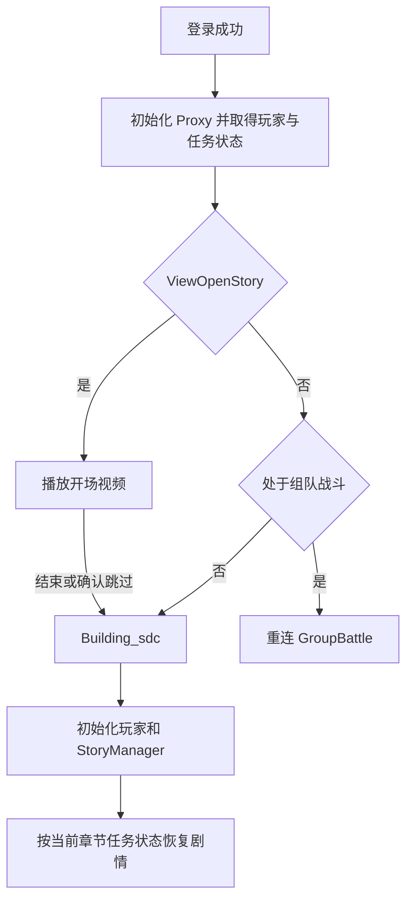
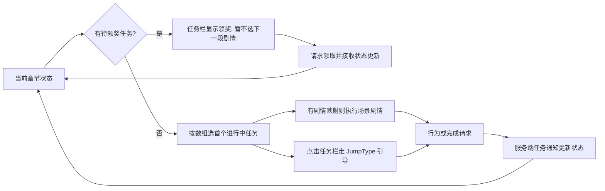

# 原作体验：进入游戏、新手引导与章节任务

研究日期：2026-11-26。范围为本地包的解码配置及已恢复 HotUpdate 静态代码。本文按新账号进入第一章的情形还原流程，**不是一次新账号实机试玩记录**；服务端返回的章节、任务和引导状态才决定实际入口。未修改 miniwow Unity 工程。

## 1. 先看玩家经历了什么

原作开场先让玩家扮演救助村庄的人，再逐渐成为经营村庄、招募和服务英雄的人。第一章并非进入主城后立即开放所有玩法，也不是直接开始一场战斗：

**登录 → 开场视频 → 燃烧的村庄 → 学会移动取水 → 救火与救人 → 招募加伦 → 医院与药剂 → 观察英雄探索 → 扩充英雄 → 旅店与食物 → 首次关卡。**

之后第二章教收入和招募，第三章教村庄升级，第四章引入副本、税金及装备交易，第五、六章扩大队伍和装备覆盖。这是从场景操作逐步过渡到经营循环的安排。

证据分三类：下文的任务 ID、奖励、条件来自**配置**；入口、互动顺序和状态处理来自**静态消费代码**；“教学目的”“设计技巧”是据此作出的**设计推断**。没有把静态代码当作运行验收。

## 2. 进入游戏不是固定跳转

|阶段|已确认的实现|对体验的影响|
|---|---|---|
|登录页|LoginGameMode 打开 Login/LoginPage；LoginPage.Login 调用 BootModule.Login，成功后 EnterGame|需先获得登录结果，不能把按钮点击等同成功|
|初始数据|BootModule.EnterGame 注册各 Proxy，等待 WaitForProxies，调用 AfterRequestData 并 Reset 引导|章节、角色、建筑等状态先准备，再决定进入场景|
|首次剧情条件|PlayerProxy 根据 `ack.guide == -1` 设置 ViewOpenStory|是否播放开场由登录数据决定|
|开场剧情|进入 OpenStory；UIOpenStoryView 播放 `Assets/Data/Videos/startVideo.mp4`，音乐 start_game.ogg|当前可证的开场是视频，不是按 tbopenstory 四行轮播|
|结束或跳过|视频结束，或确认“是否确认跳过剧情?”，调用 StartGame → RequestViewOpenStory → Building_sdc|跳过的是开场视频，不代表跳过后续救火教学|
|非首次进入|没有开场标记时，检查 inGroupBattle，重连 GroupBattle；否则 Building_sdc|老账号可能回到组队战斗，不能强制从第一章重新开始|

证据：[BootModule.EnterGame](../code-study/managed/decompiled/HotUpdate/Zombie/BootModule.cs)、[LoginPage.Login](../code-study/managed/decompiled/HotUpdate/Zombie/LoginPage.cs)、[PlayerProxy](../code-study/managed/decompiled/HotUpdate/Zombie/PlayerProxy.cs)、[UIOpenStoryView](../code-study/managed/decompiled/HotUpdate/Zombie/UIOpenStoryView.cs)。登录协议、平台授权的所有分支未逐一运行验证。

## 3. 不能把三套引导混为一谈

|机制|数据/代码|当前确认的作用|
|---|---|---|
|场景剧情|StoryManager + GuideStoryController|章节任务派发救火、救人、免费英雄等演出，部分行为直接写在控制器中|
|任务按钮导航|tbtask.JumpType → tbguidetask → GuideManager|未完成任务点击后，导航、开 UI、手指提示、对话等；有成功/失败后继|
|另一套通用引导|tbguide + GuideSystem；另有 tbguidetrigger|配置与执行类存在，但在当前恢复的 HotUpdate 中未找到 GuideSystem 实例化和触发表的业务调用，不能据此认定是当前新手入口|

表数量：tbtask 1,397 行；tbchaptertask 114 行；tbguidetask 1,594 行；tbguide 659 行；tbguidetrigger 15 行；tbopenstory 4 行。表存在不等于全部在当前流程中生效。对 tbopenstory 和 tbguidetrigger 的检索只找到生成表相关代码；不据此断言整个产品已废弃它们，仍可能有其他程序集或动态调用。

StoryManager 的明确映射为：60001～60004 → GuideStoryController.Story1～4；60101 → Story5；60112、60113、60114、60218、60219 → StoryManager 自身的五段剧情。

## 4. 最初四个任务：先救村庄

证据：[GuideStoryController](../code-study/managed/decompiled/HotUpdate/Zombie/GuideStoryController.cs) 的 Story1～5、OnGetWater、HandleNotification；[对话表](tables/tbconversation.json) 的 GroupID 3042、3043、3044、3045、3053。

|任务|玩家动作与提示|场景反馈与推进|教学目的（推断）|
|---|---|---|---|
|60001 打水去交易行救火|牧师要求先去水井；初始隐藏任务面板；指向取水点，并在 JoystickPivot 显示手指提示；取水后去交易行点击“救火”|显示携水 10；救火表现使用 10 水；喷水和延迟演出后交易行恢复，商人出现；请求完成任务，对话后指向任务栏|先学移动、抵达触发、携带资源与场景交互，再认识任务栏|
|60002 打水去旅店和医院救火|再次取水；这次水井气泡可点击并触发移动；先旅店，后医院|显示 10 水，旅店用 5 后余 5；老板感谢并要求去隔壁；医院用剩余 5 后呈倒塌状态；请求任务完成|重复基本动作，同时加入分配资源和连续目标|
|60003 救出受困的英雄|点击“清理倒塌的横梁”，再点击“救出困住的人”|清理进度 3 秒，救人进度 1 秒；完成请求回调中以 Backpack 类型自动领取任务|从移动/资源气泡扩展到有耗时的工作交互|
|60004 招募石盾加伦|看见受伤的英雄并听其对话，点击“招募”|临时英雄模型为 125，血条表现 20/100；RequestHeroReceive(125) 成功后移除临时模型；NewHeroPageClose 消息在引导模式下触发领取 60004|把救援结果变成可拥有的英雄，并为治疗需求提供原因|

细节边界：水量是脚本气泡与演出参数，不能据此认定同等数量已经在服务端背包中完成扣除；OnGetWater 创建的飞行图标列表数量也不等于水量。3 秒和 1 秒是这两个脚本进度，不是整个新手阶段耗时。20/100 是临时模型的演出血条，不能当成英雄最终属性配置。

前三个任务条件名为 FinishTalk，但实际覆盖救火、清理、救援等动作，再由客户端请求完成。**不能把 FinishTalk 机械解释为只需播放一段对话。** 第四个条件为 ReceiveFreeHero，参数 125。

引导模式的判定是 `!FinishedChapterTasks.Contains(60004)`。60101 对应的 Story5 播放牧师要求修医院的对话与过渡，隐藏火灾区域、恢复 NPC 和场景，并刷新主 UI 引导模式。消除火焰、剧情中的建筑外观恢复、正式建筑升级是不同层面的变化，不能混为一次“解锁”。

## 5. 第一章的完整 18 步

以下顺序严格来自 tbchaptertask.ID=1 的 TaskId 数组。60112～60114 位于 60107 前面；按数字排序会把招募与旅店教学串错。

|顺序|任务 ID|玩家目标|本阶段新认识的内容|
|---|---|---|---|
|1|60001|打水去交易行救火|摇杆移动、取水、交互气泡|
|2|60002|打水去旅店和医院救火|连续目标与携带数量|
|3|60003|救出受困的英雄|清理、救援进度|
|4|60004|招募石盾加伦|免费英雄接收|
|5|60101|使用退伍金修复医院|建筑等级达到 1，医院 ID60018|
|6|60102|购买宁神花|商店购买；目标 1 次，参数77001|
|7|60103|生产微效药剂|生产物品77101|
|8|60104|等待加伦疗伤|医院消费行为，条件 UseCostItem/60018|
|9|60105|观察加伦前往探索|英雄探索行为，条件 AdventureEventTimes/4|
|10|60106|与兄弟对话|获得残破的狮鹫哨83010×1|
|11|60112|去狮鹫管理员吹响哨子|招募场景交互|
|12|60113|招募影刃凯|免费英雄129|
|13|60114|招募快枪托比|免费英雄133|
|14|60107|为英雄们修复旅店|建筑60017升级到1|
|15|60108|购买1个美味小鱼|购买原料77011|
|16|60109|找旅店老板生产炸鱼|生产物品77111|
|17|60110|等待他们享用炸鱼|旅店消费行为，条件 UseCostItem/60017|
|18|60111|通关霍尔山1.山脚|关卡101001；任务金币奖励400|

购买宁神花任务额外奖励宁神花50，购买小鱼任务额外奖励小鱼50；这两步将“买一次”的教学和后续生产原料衔接起来。前三个救援任务以及招募加伦的 Reward 数组为空，仍有场景变化和英雄接收，**空任务奖励不等于没有玩家收益**。退伍金的实际发放来源不由60101奖励20金币解释，需要另查初始状态及对应剧情/经济链。

任务表中的“观察”“等待”值得保留：玩家并非只点完成按钮，也在看英雄消费药品、补给和出发。这支持“经营服务英雄”的设计解读，但探索参数4的服务端计数时机尚未验证，不把文案替代条件实现。

## 6. 任务栏、剧情和领奖怎样配合

[UIMainView.RefreshTaskCom/OnClickTaskBtn](../code-study/managed/decompiled/HotUpdate/Zombie/UIMainView.cs) 优先找本章节 status=1 的任务，再找 status=0；显示描述、进度及任务状态。status=0 点击走 GotoTaskGuide，status=1 点击请求领奖。当前 UI 消费逻辑中的 0 是进行中，1 是待领奖。

[StoryManager.GetCurrentUnfinishedMainTaskID](../code-study/managed/decompiled/HotUpdate/Zombie/StoryManager.cs) 同样按章节数组查找，但只要存在待领奖任务就返回 -1，不选下一条进行中任务执行剧情。不能把“领奖前不会启动下一段脚本”扩大成“服务器不会并行累计其他任务进度”。

[TaskProxy](../code-study/managed/decompiled/HotUpdate/Zombie/TaskProxy.cs) 的 RequestTaskInit 从返回数据取得 Chapter、ChapterLoop、ChapterTasks 和 FinishedChapterTasks。RequestTaskFinishTalk 是请求，不是本地直接把任务设为完成；TaskReceiveRequest 则处理领取及奖励表现。因此不能靠客户端配置完全推算新账号初始资产、进度更新时机或断线后的服务端结算。

恢复体验应从服务端任务快照恢复章节和场景，而不是单独保存一个本地“播放到第几段”。60003 自动领取、60004 新英雄页面关闭时领取，也说明不能要求每一个节点都手动点任务栏。

## 7. 任务导航图怎样读

[TaskProxy.GotoTaskGuide](../code-study/managed/decompiled/HotUpdate/Zombie/TaskProxy.cs) 将非0 JumpType 传给 [GuideManager.StartGuide](../code-study/managed/decompiled/HotUpdate/GuideManager.cs)，读取的是 **tbguidetask**。

- Action/ActionParam 描述当前动作；动作可包含 Navigation、OpenUI、GuideFinger、Conversation、Wait 等。
- NextID 是成功后继，FNextID 是失败后继；结束条件不能简单当作“ID加1”。
- NeedSave 为真时请求保存 GroupID；已存在于玩家 guideTrigger 的组会被 StartGuide 拒绝再次启动。
- 开始新任务引导可以终止已有弱引导；导航也有中断路径。引导结束与任务达标不是同一件事。
- 前四个救援任务 JumpType=0，靠场景剧情引导；不能将其误判为缺失引导。

例如1000003导航至 Horn_60004/Collider；60101的导航入口1001004、60102入口1016001等都已展开到附录。图中保留两类后继且去重遍历，不把分支摊平成唯一执行顺序。手指遮罩的具体阻挡范围、所有失败动作的运行结果未实机验证。

## 8. 后续章节怎样把体验扩大

|章节|配置目标的组织|体验递进（推断）|
|---|---|---|
|2，5个任务|领取医院收入 → 对话 → 吹哨 → 招募一次 → 集结旧山道|让服务行为产生收入，再把收入/招募带回队伍；“集结”条件不等于“通关”|
|3，4个任务|了解升级 → 临时营地II → 累计招募3 → 通关旧山道|将建筑经营扩展为村庄等级与队伍规模|
|4，5个任务|铁匠对话 → 任意副本 → 税金分红 → 制造交易法杖 → 制造交易火枪|建立副本、经营收入、制造、英雄装备之间的联系|
|5，5个任务|任意副本 → 6名英雄有武器 → 集结碎石坡 → 临时营地III → 狮鹫管理员对话|从制作单件装备转为覆盖整个队伍|
|6，4个任务|累计招募6 → 新上阵英雄 → 7名英雄有武器 → 通关林间岔路|扩大阵容并推进新关卡|
|7，6个任务|初级村庄 → 探索2级 → 铁匠2级 → 制造并出售绿品武器 → 副本|在熟悉的生产/交易循环上提高品质|
|8，5个任务|3名英雄有绿武器 → 裁缝、防具 → 首饰店、饰品|扩展装备部位|

60754 文案是“新上阵1名英雄”，但 EquipHeroTimes 目标值为7；这是必须核对计数口径的例子，不能直接把 FinishValue 改成1。客户端配置本身也不能证明服务器每次如何累计。

完整索引覆盖 **114章、754个任务位置**，见 [CHAPTER-EXPERIENCE.md](CHAPTER-EXPERIENCE.md)。754是章节数组中的位置数量，不能与tbtask的1,397条定义混为一谈。

## 9. 功能开放需要额外一层判断

tbfeatureunlock 中，Hospital 的 ChapterTask 条件关联60004；Box、Bless、FameTech、FameShop、Hotel、Exploration、AuctionHouse、Graveyard、Tax等关联60101；HeroCall关联60217；WeaponStore与WeaponStorePaper关联60329；EventLevel关联60756。

这些是**配置条件关联**。不能从关联推断所有按钮同时显示、立刻可操作或系统已实际初始化；还应结合服务端功能状态、UI控制器、建筑等级和页面条件。索引保留每项完整 UnlockNeedCondition，避免只截出一个任务 ID 就宣布开放。

## 10. 对 miniwow 后续实现的启示

以下是设计建议，不是本轮已实现功能，也不是照搬原作类结构：

1. 先完成“救火 → 救人 → 获得加伦”的最小体验片段。需要任务状态、玩家携带表现、场景交互目标、火灾/建筑阶段、招募结果与 UI反馈一起可用；只做任务面板无法还原体验。
2. 再做“医院 → 原料 → 药剂 → 英雄治疗 → 探索”，让第一次经营行为产生可见的角色行为。
3. 最后接入旅店、食物和首次关卡，验证补给与探索循环。新手叙事、行为达标、领奖、引导导航应分别建模，不能用单一递增步骤号代替。
4. 沿用现有 HomeSystem/HomeRuntime、ActorEntity/ActorShape 的职责。原作 StoryManager/Proxy 是证据参考，不授权引入系统间直接引用或另造一个 TownSystem。
5. 本地 DEMO 若没有原作服务器，应明确设计本地任务/经济规则及持久化；不能假装还原了原服务端。优先记录任务条件、奖励和导航的配置关系，场景动作再引用这些稳定 ID。

## 11. 可复查资料与剩余验证

- [完整章节表与第一章导航节点](CHAPTER-EXPERIENCE.md)：目标、条件参数、奖励、导航入口、开放条件。
- [机器索引](experience-index.json)：完整任务记录、导航图、开放条件及17份输入 SHA-256；由脚本生成。
- [复现脚本](../../tools/config-study/index_experience.py)：在 miniwow 根目录执行 `python -X utf8 tools/config-study/index_experience.py`。
- [原始配置专题](README.md)：解码来源、覆盖和边界。

本次索引检查：114章的754个任务位置均能找到定义，所用任务导航的成功/失败后继均可解析，缺失引用0。此结果只验证所遍历关系，不等同所有表、行为参数及服务器条件均正确。

后续需要原作新账号录像或可授权的运行样本核实：实际初始资产、开场视频内容与时长、全部按钮显示时机、任务通知与领奖的网络时序、退出后救火场景恢复、真实移动与镜头限制、首次探索和战斗如何衔接。当前不虚构这些细节，也不估计整个教程需几分钟。
